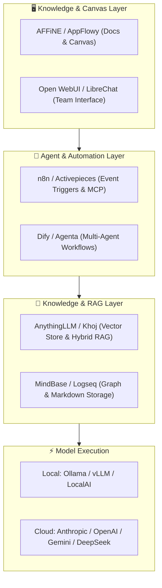

  

  
  
  
  
  
  

---

# 🚀 Awesome All-In-One AI Workspace

> ⚡ **A curated directory of top-tier SaaS platforms and open-source GitHub projects for All-in-One AI Workspaces, Personal Knowledge Management (PKM), Autonomous Agent Teams, and Unified Collaboration.**

An **All-in-One AI Workspace** bridges traditional docs, spreadsheets, project management, infinite canvas whiteboards, and intelligent AI coworkers into a unified operating system. Rather than context-switching between disconnected apps, knowledge workers and engineering teams leverage these environments to synthesize information, orchestrate multi-agent workflows, and maintain deep institutional memory.

---

## 📑 Table of Contents

- [📊 Sector Overview & Market Dynamics](#-sector-overview--market-dynamics)
- [☁️ SaaS & Hosted AI Workspaces](#️-saas--hosted-ai-workspaces)
- [💻 Open-Source GitHub Projects (Ranked by ⭐ Stars)](#-open-source-github-projects-ranked-by--stars)
- [🏗️ Recommended Architectural Stacks](#️-recommended-architectural-stacks)
- [🛡️ Security, Privacy & Local-First Principles](#️-security-privacy--local-first-principles)
- [🤝 How to Contribute](#-how-to-contribute)
- [💖 Support & Community](#-support--community)
- [⭐ Star History](#-star-history)
- [⚖️ Disclaimer & License](#️-disclaimer--license)

---

## 📊 Sector Overview & Market Dynamics

The global **AI Workspace & Productivity Software** sector is estimated at **$60B – $85B+** (projected to expand at a compound annual growth rate exceeding **26% CAGR** through 2030, accelerated by pervasive enterprise adoption of generative AI agents and intelligent knowledge retrieval).

The market exhibits a **moderately fragmented landscape that is actively polarizing into two distinct spheres**:
1. **The 'Winner-Take-Most' Enterprise Core:** Mega-platforms and category-defining incumbent suites (*Notion*, *ClickUp*, *Microsoft 365 Copilot*, *Coda*) leverage extensive distribution and enterprise compliance to consolidate broad everyday office collaboration and team documentation.
2. **The High-Velocity Modular & Open-Source Frontier:** Strong fragmentation flourishes around specialized frontiers—specifically **local-first privacy platforms** (*AFFiNE*, *AppFlowy*, *Logseq*), **agentic workflow orchestrators** (*n8n*, *Dify*, *Flowise*), and **self-hosted sovereign LLM interfaces** (*Open WebUI*, *LibreChat*, *Khoj*). Developers and data-sensitive enterprises consistently favor these modular, unbundled, and vendor-neutral alternatives to avoid proprietary cloud lock-in.

---

## ☁️ SaaS & Hosted AI Workspaces

The following leading hosted solutions represent category benchmarks in unified documentation, task tracking, and embedded generative AI.

> *Note: Platforms below are sorted in **descending order by company scale** (estimated valuation / annual recurring revenue).*

| Platform | Company Scale (Valuation / Revenue) | Starting Tier Pricing | Free Tier / Trial Limits | Key Capabilities & Focus |
| :--- | :--- | :--- | :--- | :--- |
| **[Notion AI](https://www.notion.so/product/ai)** | **~$10.0B Valuation** *(~$250M+ ARR)* | **$10/user/mo** *($8/user/mo billed annually for Plus plan; Notion AI available as +$10/user/mo add-on or $8/mo billed annually)* | **Free forever plan:** Unlimited pages/blocks for individuals (1,000 block limit for trial teams), up to 10 guests, 5MB file upload limit; includes a complimentary trial of 20 Notion AI responses. | Unified connected workspace combining docs, wikis, relational databases, and enterprise AI Q&A. Automatically extracts action items, drafts content, and queries workspace history. |
| **[ClickUp Brain](https://clickup.com/ai)** | **~$4.0B Valuation** *(~$175M+ ARR)* | **$10/user/mo** *($7/user/mo billed annually for Unlimited plan) + $7/user/mo for ClickUp Brain add-on* | **Free forever plan:** 100MB cloud storage, unlimited tasks, collaborative docs, real-time chat, and 2FA; includes a trial of 50 ClickUp Brain AI uses. | All-in-one project management and sprint tracker featuring an integrated AI Knowledge Manager, AI Project Manager, and autonomous AI Writer. |
| **[Coda AI](https://coda.io/product/ai)** | **~$1.4B Valuation** *(~$40M+ ARR)* | **$12/doc-maker/mo** *($10/doc-maker/mo billed annually for Pro plan; editors & viewers are always free)* | **Free forever plan:** Unlimited unshared docs, 50 objects per doc, 35 automations/month, and an initial trial allocation of 100 Coda AI credits. | Blends collaborative documents with spreadsheet computation, interactive app packs, table formulas, and inline AI prompt columns. |
| **[Mem.ai](https://mem.ai/)** | **~$110M Valuation** *(OpenAI Startup Fund backed)* | **$14.99/mo** *($8.33/mo billed annually for Mem+)* | **Free forever plan:** Unlimited individual notes, 25MB file attachment cap, search indexing, and a 50-prompt AI assistant trial limit. | AI-native self-organizing digital notebook. Automatically cross-references related concepts, generates smart summaries, and synthesizes personal collections without manual tags. |
| **[Taskade](https://www.taskade.com/)** | **~$80M Valuation** *(YC-backed, ~$8M ARR)* | **$8/user/mo** *($4/user/mo billed annually for Starter plan, covers up to 3 seats)* | **Free forever plan:** 250MB storage, 1 workspace, 3 collaborators, and 1,000 AI generation credits renewed monthly. | Real-time AI workflow engine integrating Kanban boards, task lists, mind mapping, team video chat, and autonomous custom AI Agent builders. |
| **[Craft AI](https://www.craft.do/)** | **~$75M Valuation** *(Series B, ~$6M ARR)* | **$10/user/mo** *($8/user/mo billed annually for Plus plan)* | **Free forever plan:** Up to 1,000 blocks, 1GB cloud storage, 5 team members, and a lifetime trial of 20 AI Assistant queries. | Design-centric, native Apple and web document editor featuring rich visual styling, deep linking, nested card blocks, and integrated AI writing transformations. |
| **[Slite](https://slite.com/)** | **~$40M Valuation** *(Series A, ~$4M ARR)* | **$10/user/mo** *($8/user/mo billed annually for Standard plan)* | **Free forever plan:** Up to 50 team docs, unlimited members, and a 14-day full free trial of Slite "Ask" AI search (followed by 5 AI queries/month free). | Knowledge base for distributed teams with AI-powered semantic search ("Ask"), automated document verification workflows, and stale content auditing. |
| **[Anytype](https://anytype.io/)** | **~$35M Valuation** *(~$13.4M venture funding)* | **$10/mo** *($8.25/mo billed annually for Plus plan with 100GB encrypted cloud sync)* | **Free forever plan:** 100% offline-first functionality, unlimited local devices and local documents, and 1GB encrypted peer-to-peer cloud backup sync. | Local-first, decentralized, and end-to-end encrypted knowledge operating system. Treats every entry as a typed object within a customizable relational graph. |
| **[Capacities](https://capacities.io/)** | **~$15M Valuation** *(Bootstrapped / Seed)* | **$12/mo** *($10/mo billed annually for Pro plan); $25/mo ($20/mo billed annually for Pro + AI package)* | **Free forever plan:** Unlimited objects, spaces, media embeds, and multi-device sync; includes a 7-day free trial of Capacities AI Assistant. | "A studio for your mind" utilizing object-oriented note-taking (ideas, meetings, books, projects) linked together into an interconnected knowledge web. |

---

## 💻 Open-Source GitHub Projects (Ranked by ⭐ Stars)

Curated open-source repositories powering sovereign, self-hosted, and transparent AI workspaces.

> *Repositories are ordered strictly in **descending order by GitHub star count**.*

- **[n8n](https://github.com/n8n-io/n8n)**   
  ⚡ *Fair-code workflow automation and multi-agent coordination platform.* Connects over 400+ services, native LangChain nodes, and autonomous agent execution loops to automate complex business and workspace operations with full self-hosting freedom.

- **[Dify](https://github.com/langgenius/dify)**   
  🛠️ *Open-source LLM app development and agent orchestration workspace.* Features visual prompt engineering, high-performance RAG pipelines, data ingestion from Notion/documents, and seamless deployment of multi-agent team assistants.

- **[Open WebUI](https://github.com/open-webui/open-webui)**   
  🌐 *Extensible, feature-packed AI workspace and interface for local and cloud models.* Native Ollama and OpenAI-compatible API support, document RAG, custom tool/function calling, persona-based prompts, multi-model side-by-side chat, and granular role-based access control.

- **[LobeChat](https://github.com/lobehub/lobehub)**   
  🎨 *Modern, responsive AI workspace and chat framework.* Supports multi-modal interactions (TTS, STT, vision), expansive plugin marketplace, multi-agent roles, visual artifacts, and local-first SQLite/IndexedDB data ownership.

- **[AppFlowy](https://github.com/AppFlowy-IO/AppFlowy)**   
  📖 *The premier open-source Notion alternative with built-in AI.* Written in Flutter and Rust, offering native desktop and mobile performance, collaborative boards, rich document wikis, and local offline-first privacy with on-device AI model integrations.

- **[AFFiNE](https://github.com/toeverything/AFFiNE)**   
  🖌️ *Next-gen collaborative workspace bridging structured documents and infinite canvas.* Offers edgeless whiteboarding, mind mapping, and markdown docs with AFFiNE AI assistance for presentation generation, summarization, and local-first Docker self-hosting.

- **[AnythingLLM](https://github.com/Mintplex-Labs/anything-llm)**   
  📦 *All-in-one desktop and enterprise AI workspace.* Turn documents, PDFs, and workspaces into a conversational vector knowledge base with zero configuration. Works with Ollama, LM Studio, or cloud providers with built-in multi-user management.

- **[Flowise](https://github.com/FlowiseAI/Flowise)**   
  🧩 *Drag-and-drop UI to build customized LLM flows and autonomous agents.* Visually assemble conversational RAG pipelines, workspace Q&A bots, and autonomous tool-using agents backed by LangChain and LlamaIndex.

- **[LibreChat](https://github.com/LibreChat-AI/LibreChat)**   
  💬 *Enhanced, multi-provider AI workspace.* Features Model Context Protocol (MCP) support, Artifacts, code interpreter execution, multi-user authentication, file attachments, and centralized routing across Anthropic, OpenAI, Gemini, DeepSeek, and local LLMs.

- **[Logseq](https://github.com/logseq/logseq)**   
  🧠 *Privacy-first, open-source knowledge graph and outliner.* Stores your thoughts as plain-text Markdown or Org-mode files on your local file system, with bidirectional linking, flashcards, task tracking, and community AI plugins.

- **[Khoj](https://github.com/khoj-ai/khoj)**   
  🔍 *An autonomous AI second brain and personal assistant.* Deeply indexes your local files, Markdown notes, Obsidian vaults, and web links; performs iterative web research and executes scheduled tasks via desktop, mobile, and Emacs.

- **[Activepieces](https://github.com/activepieces/activepieces)**   
  🔄 *Open-source business automation platform with Model Context Protocol (MCP) and AI agents.* Provides ~400+ pre-built integrations, sandboxed code execution, and visual flow design for connecting workspace data to AI workflows.

- **[Agenta](https://github.com/Agenta-AI/agenta)**   
  🤝 *Collaborative workspace for teams to build, test, and deploy AI agents.* Build agents interactively through conversational prompts, connect real-world apps, automate recurring tasks, and manage role-based tool execution in sandboxed environments.

- **[Berd (Block)](https://github.com/block/berd)**   
  🖥️ *Desktop agent workspace from Block (Apache-2.0).* Executes tasks across diverse models and local harnesses, storing conversation state and task artifacts on your local device with enterprise configuration distribution.

- **[Notex](https://github.com/smallnest/notex)**   
  📓 *Privacy-preserving, open-source alternative to NotebookLM.* Ingest PDFs, Markdown docs, and web pages into topic notebooks to perform grounded citations, generate quizzes, flashcards, and audio podcast outlines using Ollama or OpenAI.

- **[MindBase](https://github.com/frankchu91/mindbase-llm-wiki)**   
  📚 *AI-maintained Markdown wiki inspired by Karpathy's LLM Wiki paradigm.* Ingests raw notes and articles, cross-references statements, resolves contradictions, and compiles knowledge into a clean 3-layer structured local wiki via local Ollama models.

- **[Libre WebUI](https://github.com/libre-webui/libre-webui)**   
  🔒 *Local-first workspace for isolated model-driven tasks.* Provides isolated sandboxed execution per task, bounded shell operations, virtual desktop preview, revision history, and custom personas without cloud telemetry.

- **[okforge / OpenKB](https://github.com/okforge/okforge)**   
  🗂️ *Local-first knowledge compiler and 3D concept graph.* Pre-compiles source documents into verifiable concept and entity pages following the Open Knowledge Format (OKF v0.2) with strict page-level citation tracing.

---

## 🏗️ Recommended Architectural Stacks

For developers, research labs, and privacy-conscious organizations designing a sovereign AI workspace:

---

## 🛡️ Security, Privacy & Local-First Principles

When evaluating or architecting all-in-one AI workspaces for sensitive company intelligence:

1. **Least-Privilege Agent Permissions:** Agents equipped with file-system writes, shell executions, or browser automation must operate inside hardened, sandboxed containers rather than raw host environments.
2. **Data Sovereign Vector Stores:** Local-first tools (*MindBase*, *Khoj*, *AnythingLLM*) store vector embeddings and document chunks strictly on-premise, preventing proprietary knowledge ingestion by public foundational models.
3. **Auditable Citations:** Prioritize solutions that cite exact source page offsets (such as *Notex* or *okforge*) to eliminate LLM hallucinations across critical enterprise records.

---

## 🤝 How to Contribute

We actively welcome community contributions to keep this ecosystem comprehensive, accurate, and up-to-date!

1. 🍴 **Fork the repository** on GitHub.
2. 🌿 **Create a new branch** (`git checkout -b feature/add-new-tool`).
3. 📝 **Add or update the platform** in `README.md`:
   - Follow the established formatting conventions (include company scale, precise starting pricing, specific free tier limits, and live star count badges).
   - Ensure open-source entries link directly to their stargazers page badge.
4. 🚀 **Submit a Pull Request** with a concise description of why the tool adds value to the ecosystem.

---

## 💖 Support & Community

Thank you for exploring and utilizing **Awesome-All-In-One-AI-Workspace**! 🎉

If you find this ecosystem directory valuable:
- ⭐ **Star this repository** to help others in the AI community discover it!
- 🍴 **Fork it** and contribute your favorite open-source tools and workflows!
- 📢 **Share it** on X / Twitter, LinkedIn, Reddit, or Discord!

### ☕ Sponsor & Buy a Coffee
If you'd like to support ongoing curation, automated indexing, and open-source research:  
👉 **[Sponsor @ishandutta2007 on GitHub Sponsors](https://github.com/sponsors/ishandutta2007)** 💖

---

## ⭐ Star History

---

## ⚖️ Disclaimer & License

- This repository is a community-curated directory intended for research, architectural planning, and educational purposes. Mentions do not constitute an explicit commercial endorsement.
- Distributed under the [MIT License](LICENSE). Maintained with care by [@ishandutta2007](https://github.com/ishandutta2007) and contributors.
